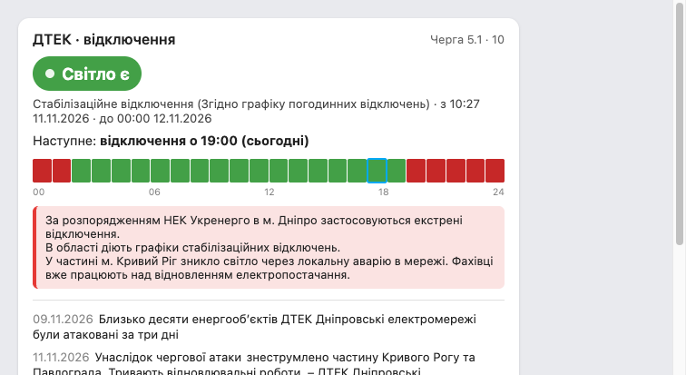

# ДТЕК відключення — картка для Home Assistant

[English below](#english)

Картка Lovelace + скрапер офіційного сайту [ДТЕК Дніпрообленерго](https://www.dtek-dnem.com.ua/ua/shutdowns):
поточний статус світла по **вашій адресі**, графік погодинних відключень на день,
екстрені банери й новини. Без хмари, без сторонніх сервісів, без API-ключів —
все локально.



## Як це працює

```
dtek-dnem.com.ua ──(скрапер, cron/systemd кожні 10 хв)──▶ /www/dtek_outage/state.json ──▶ картка
```

- `scraper/dtek_scraper.py` — чистий Python (`curl_cffi`), тягне статус по адресі з офіційного сайту.
- `dtek-outage-card.js` — картка без залежностей; сама завантажує `state.json` і оновлюється.
- Обхід Incapsula/Imperva — **без браузера**: challenge-відповідь віддає свіжу сесійну куку
  у `Set-Cookie`, другий запит проходить. Сесія самовідновлювана (деталі: [docs/API.md](docs/API.md)).

## Встановлення

### 1. Скрапер (можна на будь-якій машині, що бачить інтернет)

```bash
pip install curl_cffi
python3 scraper/dtek_scraper.py --city "м. Дніпро" --street "вул. Прикладова" --house "10" \
    --out /srv/homeassistant/config/www/dtek_outage/state.json
```

Адресу варто взяти з підказок самого сайту (сторінка «Графік відключень»): скрапер
свірить вуличний довідник і шукає точний ключ будинку. Для автозапуску кожні 10 хв —
`deploy/dtek-scraper.service` + `.timer` (systemd) або звичайний cron.

Альтернатива без файлу — push у `POST /api/states/sensor.dtek_outage` (токен довгого
життя з профілю HA): прапорець `--push-url` + `--push-token`, приклад у `docs/HA_SETUP.md`.

### 2. Картка

**Через HACS:** ⋮ → *Custom repositories* → додати URL цього репозиторію
(тип *Frontend*) → встановити «DTEK Outage Card».

**Вручну:** покласти `dtek-outage-card.js` у `<config>/www/`, потім
*Settings → Dashboards → Resources → Add*: `/local/dtek-outage-card.js`, тип *JavaScript module*.

### 3. Картка на дашборді

```yaml
type: custom:dtek-outage-card
# опційно:
# fetch_url: /local/dtek_outage/state.json   # за замовчуванням
# refresh_minutes: 10
# entity: sensor.dtek_outage                 # читати з HA-сенсора замість fetch
# title: ДТЕК · відключення
```

Повний шлях налаштування (sensor, автоматизації «світло зникло → повідомлення»,
звернення до ІТ-підрозділу через `getCekText`) — [docs/HA_SETUP.md](docs/HA_SETUP.md).

## Обмеження

- Графік і статус доступні лише для клієнтів **ДТЕК Дніпрообленерго** (мережа Дніпра;
  для інших обленерго треба адаптувати скрапер — структура `state.json` навмисно проста).
- Сторінки сайту під Incapsula: якщо ДТЕК посилить захист, скрапер впаде з
  зрозумілою помилкою `[blocked]` — чекайте оновлення тут.
- Це неофіційний скрапер: не чиніть навантаження на сайт (таймер ≥ 10 хв).

## English

Lovelace card + scraper for the official [DTEK Dniprooblenergo](https://www.dtek-dnem.com.ua/ua/shutdowns)
outage site: current power status for **your address**, the hourly shutdown schedule for
the day, emergency banners and news. No cloud, no third-party services, no API keys —
everything stays local.

### How it works

```
dtek-dnem.com.ua ──(scraper, cron/systemd every 10 min)──▶ /www/dtek_outage/state.json ──▶ card
```

- `scraper/dtek_scraper.py` — plain Python (single dependency: `curl_cffi`), pulls the
  outage status for your address from the official site.
- `dtek-outage-card.js` — dependency-free card; fetches `state.json` itself and
  auto-refreshes (no sensor or YAML required).
- Incapsula/Imperva is handled **without a browser**: the challenge response issues a
  fresh session cookie via `Set-Cookie`, so a plain retry passes. The session self-heals
  even from a cold start with zero cookies (details: [docs/API.md](docs/API.md) — the
  full API reverse-engineering).

### Installation

**1. Scraper** (any internet-connected machine):

```bash
pip install curl_cffi
python3 scraper/dtek_scraper.py --city "м. Дніпро" --street "вул. Прикладова" --house "10" \
    --out /srv/homeassistant/config/www/dtek_outage/state.json
```

Take the street/house spelling from the site's own autocomplete (Shutdown schedule page) —
the scraper matches the exact house key from the site's street directory. For unattended
runs every 10 minutes: `deploy/dtek-scraper.service` + `.timer` (systemd) or plain cron.

File-free alternative — push straight into HA via `POST /api/states/sensor.dtek_outage`
(long-lived access token from your HA profile): `--push-url` + `--push-token`, example in
`docs/HA_SETUP.md`.

**2. Card.** Via HACS: ⋮ → *Custom repositories* → add this repository URL (type
*Frontend*) → install «DTEK Outage Card». Manually: copy `dtek-outage-card.js` to
`<config>/www/`, then *Settings → Dashboards → Resources → Add* →
`/local/dtek-outage-card.js`, type *JavaScript module*.

**3. Dashboard card:**

```yaml
type: custom:dtek-outage-card
# optional:
# fetch_url: /local/dtek_outage/state.json   # default
# refresh_minutes: 10
# entity: sensor.dtek_outage                 # read from an HA sensor instead of fetching
# title: ДТЕК · відключення
```

Full setup path (REST sensor, "power went out → push notification" automations, filing
a request to the utility's IT unit via `getCekText`) — [docs/HA_SETUP.md](docs/HA_SETUP.md).

### Limitations

- Schedules and status exist only for **DTEK Dniprooblenergo** customers (Dnipro grid).
  Other oblenergos require adapting the scraper — the `state.json` schema is
  deliberately simple and reusable.
- The site sits behind Incapsula: if DTEK hardens protection, the scraper will fail with
  a clear `[blocked]` error — an update will appear here.
- Unofficial scraper: be polite to the site (interval ≥ 10 minutes).

## License

MIT — © 2026 Mykola Bashmakov
